I build things where the hard part is the algorithm, usually somewhere between computer science and
biology. Computer Science and Molecular and Cell Biology at UC Berkeley, class of 2029.

Won Anthropic's Hack with Claude. Top 5 of 94 teams at the MongoDB AI hackathon with Rehearsal Room,
a voice tool for rehearsing hard conversations. Co-founded a startup that interviewed with Y
Combinator for S26, currently in stealth.

## Selected work

**[pdbpeek](https://github.com/janeulzhan/pdbpeek)**: Enter a Protein Data Bank ID and get a 3D
view plus solvent-accessible surface area and a residue contact map computed in the page from the
coordinate file, not read off an API. The Shrake-Rupley implementation agrees with FreeSASA to
within 1e-3 on four structures, and the JavaScript and Python versions are bit-identical per atom.
[Live demo](https://janeulzhan.github.io/pdbpeek/).

**[pikevm](https://github.com/janeulzhan/pikevm)**: A regex engine that matches in one
left-to-right pass: Thompson NFA construction and a Pike VM with capture groups. On `^(a|aa)+$`
against 41 characters, V8 does not finish inside two seconds and this answers in 0.005 ms. 999,940
fuzzed pattern and input pairs agree with V8 on acceptance and on every capture span.
[Live demo](https://janeulzhan.github.io/pikevm/).

**[tinyvec](https://github.com/janeulzhan/tinyvec)**: An IVF plus product-quantization vector index
built from k-means up, with asymmetric distance computation over precomputed lookup tables. On
SIFT-small, recall@10 runs from 0.403 to 1.000 across the nprobe sweep and the codes compress 32x.
The benchmark reports the case where numpy brute force wins.

**[hirsch](https://github.com/janeulzhan/hirsch)**: Optimal global alignment with affine gaps in
linear space, combining Gotoh's recurrence with Hirschberg's divide and conquer. Same optimal score
as the quadratic algorithm using 891x less memory at n=5,000. The naive way to recombine the halves
is wrong on 772 of 1,500 random pairs, and the test suite proves it.

**[phasekit](https://github.com/janeulzhan/phasekit)**: Phase retrieval for coherent diffractive
imaging, written from the projection operators up. Reports its own failure rate rather than its best
run. [Live demo](https://janeulzhan.github.io/phasekit/web/).

## Now

Research apprentice in a Berkeley MCB lab, helping build and evaluate CALoc, a Fiji and ImageJ plugin
for colocalization analysis in microscopy. Dry lab at iGEM Berkeley, on a computational pipeline for
designing peptide inhibitors.

## Contact

[LinkedIn](https://linkedin.com/in/ulzhan-khamidolla) · khamidolla.ulzhan@gmail.com
